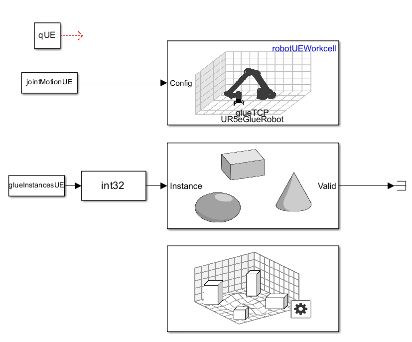
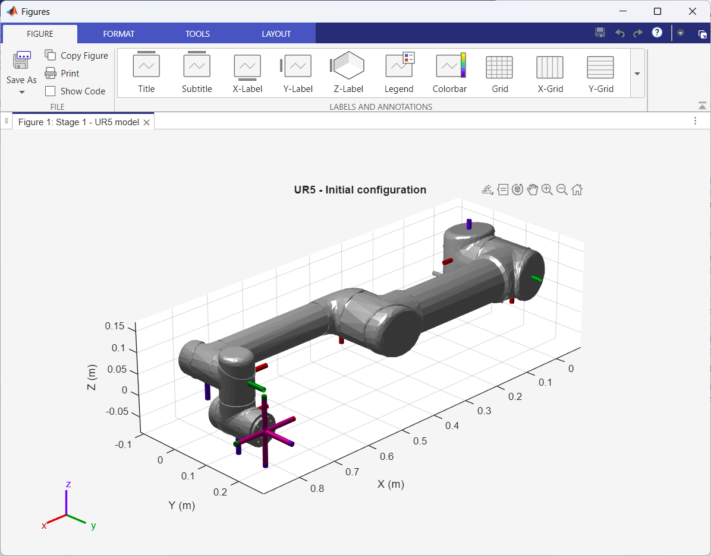
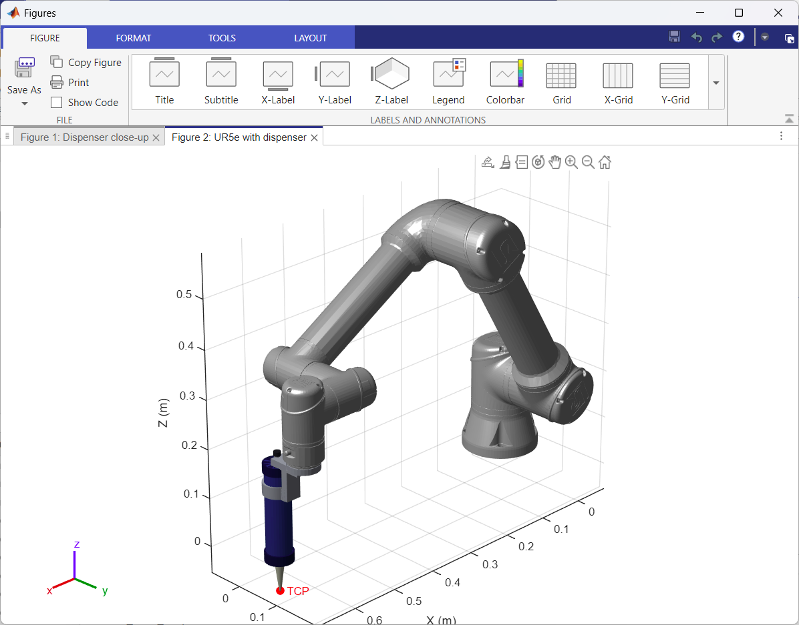
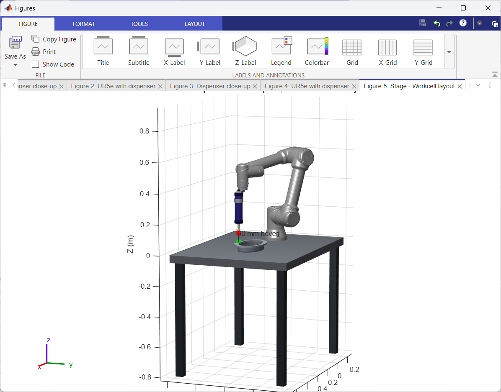
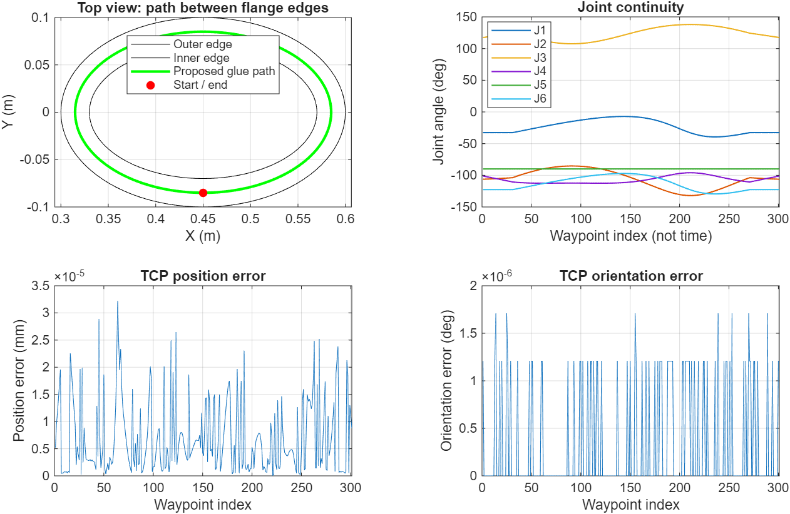
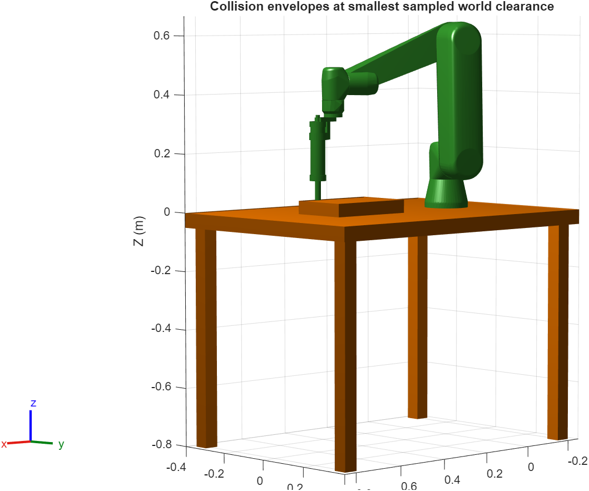
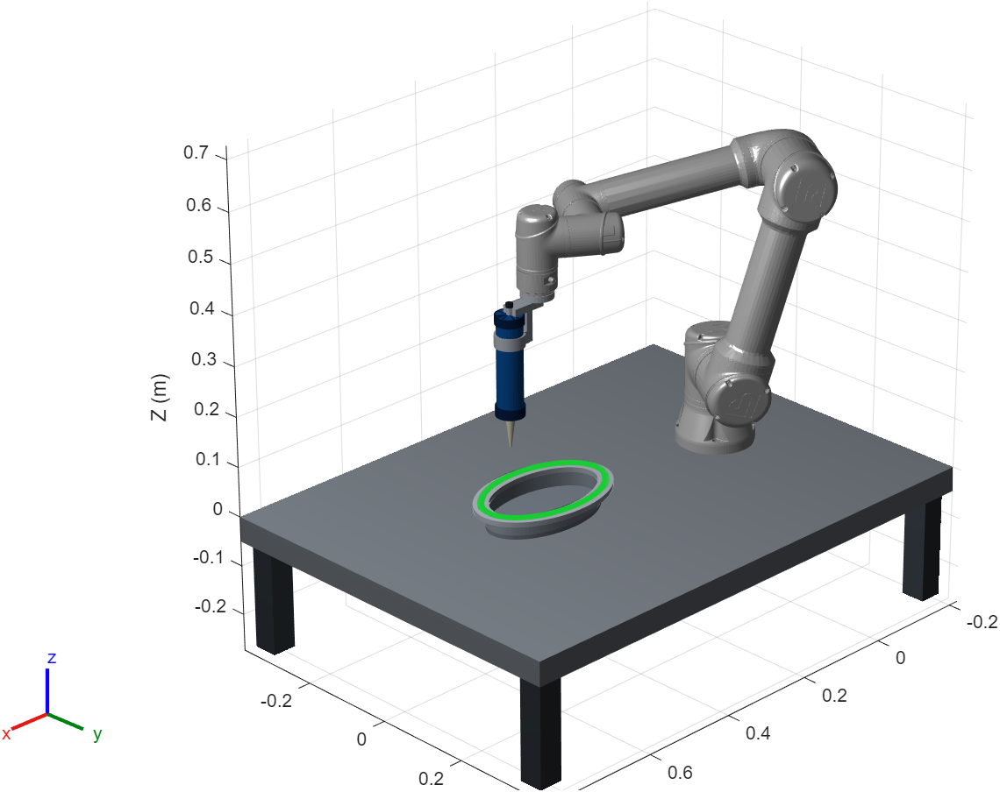
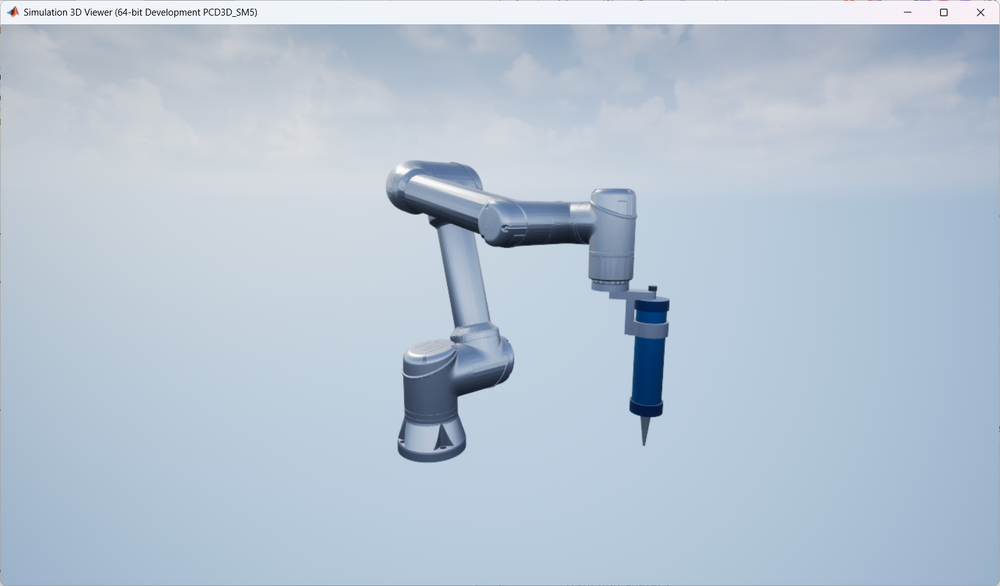
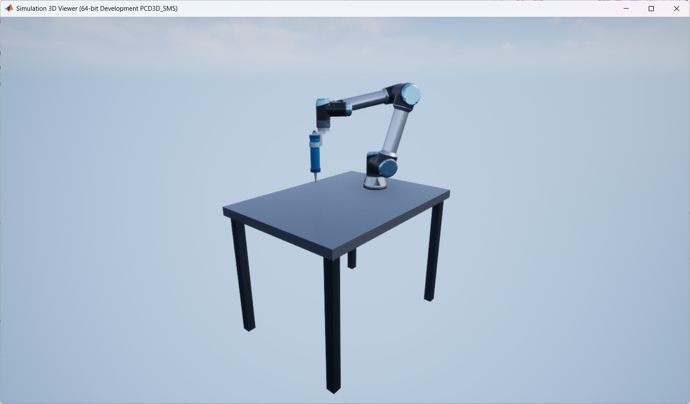
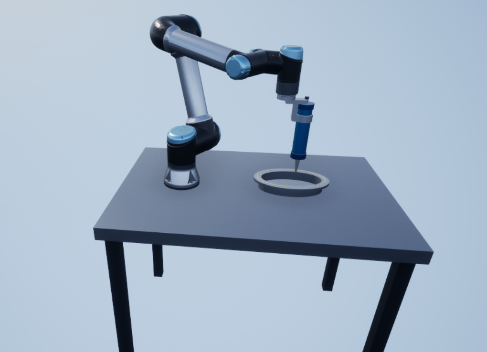

# UR5e Glue Dispensing Simulation

A step-by-step MATLAB R2025b and Simulink project for a UR5e robot applying a visual glue bead around an oval gearbox-cover flange. The workcell contains a bench, a generated cartridge dispenser, a nozzle tool center point (TCP), and a simplified cover. MATLAB prepares and checks the motion. Simulink plays the motion in the Unreal-based Simulation 3D Viewer.

This guide documents the project up to the glue-bead integration checkpoint. It is intended for a person who has not read the original development conversation.

## 1. Current status and what is included

| Feature | Status at this checkpoint |
|---|---|
| UR5e model and fixed dispenser/TCP attachment | Checked in the original MATLAB session |
| Hover inverse kinematics and oval glue path | Passed the reported pose/continuity checks |
| Sampled collisions | Passed 1,201 sampled poses after the adapter modeling correction |
| Timing and sampled singularity screens | Passed the reported demonstration screens |
| Robot colors, bench, Unreal robot motion | Visually confirmed working by the project owner |
| Progressive Unreal glue bead | Code provided; latest reported issue was incorrect block wiring; successful playback is still to be confirmed |
| Consolidated preparation script in this package | Newly assembled from those stages; requires a first run in MATLAB |

The package contains source scripts and color mesh data. **It does not contain the owner's `.slx` file**, because that file was not supplied. Section 5 explains how to create the small Simulink model once and then save it for repeat runs. No MATLAB execution was available during preparation of this package; original reported results are distinguished from new integration work below.

## 2. Requirements

The original environment was Windows 11 Pro, MATLAB R2025b.

Required products for the complete workflow:

- MATLAB R2025b.
- Robotics System Toolbox.
- Simulink.
- Simulink 3D Animation, with a graphics environment able to run Simulation 3D Viewer.

The project uses the supplied `universalUR5e` model through `loadrobot`. A physical robot, ROS connection, and a separately authored Unreal Editor project are not part of this checkpoint. It uses the prebuilt empty scene. Each recipient needs their own suitable MATLAB installation and product access.

Run `ver` to inspect installed products. If `loadrobot('universalUR5e')` asks for additional robot-model data, follow MATLAB's installation prompt before proceeding. Use R2025b Help for block names: current online documentation may describe newer releases.

## 3. Quick start

1. Extract the entire ZIP into a writable folder, for example `C:\MATLAB\UR5e_glue_dispenser`.
2. Open MATLAB and set **Current Folder** to the extracted folder containing this README and the `.m` files.
3. Run the following command in the Command Window:

```matlab
UR5e_Prepare_Project
```

4. Allow the collision checks and MATLAB animation to finish. The animation alone has about 46 seconds of nominal motion; rendering and collision calculations add time. Several diagnostic figures are expected.
5. Confirm that the collision and timing screens pass and that the final message says `Workspace ready`.
6. Check robot motion using Simulink model  `UR5e_Unreal_Checkpoint.slx` described in Section 5; then add the bead branch.

On later MATLAB sessions, prepare the workspace again, open your saved model, and run it:

```matlab
UR5e_Prepare_Project
open_system('UR5e_Unreal_Checkpoint.slx')
sim('UR5e_Unreal_Checkpoint.slx')
```

The second and third commands require the model you created and saved. Preparation does not create an SLX automatically. Stop simulation before rebuilding the workspace or changing visual geometry. Keep Fast Restart off while developing the scene.

## 4. Files and the preparation pipeline

| File | Purpose |
|---|---|
| `UR5e_Prepare_Project.m` | Single entry point: runs validation/timing, applies colors, adds visual bench/cover, and prepares Simulink inputs |
| `UR5e_Glue_Dispenser.m` | Loads UR5e; generates and attaches the tool and TCP; shows attachment figures |
| `UR5e_Workcell_Layout.m` | Defines the bench/cover and solves the initial hover pose |
| `UR5e_Check_Glue_Path.m` | Generates the approach, oval dispensing loop, and retraction; solves/checks IK |
| `UR5e_Check_Collisions.m` | Builds conservative collision geometry and checks the sampled route |
| `UR5e_Animate_Glue.m` | Screens Jacobian conditioning, creates timed motion, and animates it in MATLAB |
| `UR5e_Apply_Colors.m` | Replaces robot visuals with colored mesh regions while retaining the kinematic model |
| `UR5e_Color_Data.mat` | Region mesh data and palette used by the color function |
| `UR5e_Glue_Bead.m` | Prepares deposit positions/instance signal and initializes bead actors |

The validation scripts call earlier stages automatically. For example, `UR5e_Check_Collisions` runs path, layout, and dispenser construction first. Run an entire file; running an isolated section in a fresh workspace may leave dependencies missing.

Generated files are written beside the scripts: `dispenser_meshes/`, `colored_meshes_v4/`, `gearbox_cover_visual.stl`, and `UR5e_Bead_Data.mat`. These are recreated by preparation. Keep the source `.mat` color data; it is an input, not a disposable generated output. Re-run preparation after moving the project to another computer so mesh paths point to the new folder.

Important workspace variables:

| Variable | Meaning |
|---|---|
| `robot` | Original UR5e with dispenser and `glueTCP` |
| `robotCollision` | Separate robot used for collision review |
| `qHover` | Six joint angles at the initial hover pose |
| `qPath` | 301 geometric route configurations |
| `qDense` | 1,201 configurations used by the sampled collision check |
| `time`, `qTimed`, `phaseDurations` | Timed motion and three phase durations |
| `robotUEColored` | Colored robot and tool |
| `robotUEScene` | Colored robot plus fixed visual bench |
| `robotUEWorkcell` | Final visual tree including the cover; use this in the Robot block |
| `qUE` | Initial six-joint configuration |
| `jointMotionUE` | Numeric matrix: time column, followed by six joint angles in radians |
| `glueInstancesUE` | Numeric matrix: time column, followed by bead instance number |
| `stopTimeUE` | Finite simulation stop time, including initial/final holds |

## 5. Create the Simulink robot-motion model

### 5.1 Add three blocks

Create a blank model. Search the Library Browser or double-click the model canvas to add:

- **From Workspace** — rename it `Joint Motion`.
- **Simulation 3D Robot**.
- **Simulation 3D Scene Configuration**.

The Scene Configuration block shares the Simulation 3D environment with the other blocks; it does not need a signal wire to the robot.

### 5.2 Model settings

Open **Model Settings > Solver** and set:

| Setting | Value |
|---|---|
| Type | Fixed-step |
| Solver | Discrete (no continuous states) |
| Fixed-step size | `0.02` |
| Start time | `0` |
| Stop time | `stopTimeUE` |
| Simulation mode | Normal |

For viewing at approximately real time, enable simulation pacing at one simulated second per wall-clock second. Slow rendering can still reduce playback speed.

### 5.3 Scene Configuration

Use **Default Scenes**, select the **Empty** scene, enable the viewer, and use sample time `0.02`. Set block execution priority to `0` through block properties. Keep one scene configuration block in this model.

### 5.4 Robot block

Set the following parameters in the R2025b block dialog. Some controls become visible after selecting the rigid-body-tree input mode.

| Setting | Value |
|---|---|
| Robot source/input | RigidBodyTree object |
| Rigid body tree | `robotUEWorkcell` |
| Actor name | `UR5eGlueRobot` |
| Use existing actor | Off |
| Initial configuration | `qUE` |
| Configuration input | Enabled |
| Initial base translation | `[0 0 0]` |
| Initial base rotation | `[0 0 0]` |
| Translation/rotation input ports | Disabled for this setup |
| Grasping | Disabled |
| Visual geometry | Enabled |
| Collision geometry display | Disabled |
| Sample time | `0.02` |
| Block execution priority | `-1` |

In R2025b, the joint input port is named **Config**. It must receive the six joint angles. The bench and cover are fixed bodies in this visual tree, so they add no controlled joints.

### 5.5 Joint Motion block and connection

Set **Data** to `jointMotionUE`, **Sample time** to `0.02`, enable **Interpolate data**, and choose **Holding final value** for output after the final data value.

Connect the From Workspace output directly to the Robot block's **Config** input. The signal delivered to Config has six numeric elements; the matrix's first column is interpreted as time by From Workspace.

Run this model before adding the bead. Expected behavior: hold at hover for two seconds, descend, follow one complete oval, retract, and hold at the final pose for about two seconds. Total stop time is approximately 49.68 seconds with the recorded settings.

## 6. Add the progressive glue bead

This is the latest integration checkpoint. The bead is a visual approximation formed from overlapping small spheres placed along the dispensing portion of the route. It does not calculate adhesive flow or curing.

`UR5e_Prepare_Project` already runs:

```matlab
glueInstancesUE = UR5e_Glue_Bead('prepare', ...
    robotUEWorkcell, jointMotionUE, phaseDurations);
```

This writes `UR5e_Bead_Data.mat` beside the function. Do not delete that file between preparation and simulation. The actor callback loads it rather than relying on arbitrary base-workspace variables.

### 6.1 Add the bead blocks

Add another **From Workspace** block named `Bead Instances`, a **Data Type Conversion** block, a **Simulation 3D Actor** block, and a **Terminator**.

For `Bead Instances`: Data = `glueInstancesUE`, Sample time = `0.02`, **Interpolate data = off**, final output = **Holding final value**. Set the Data Type Conversion output type to **int32**.

For the Actor block:

| Setting | Value |
|---|---|
| Actor name | `GlueBead` — exact spelling |
| Parent | Scene Origin |
| Operation | Create at step |
| Source file | Empty |
| Sample time | `0.02` |
| Block execution priority | `-1` |
| Initial translation/rotation | Zero |
| Scale | Unit scale |

Enter this in its **Initialization script**:

```matlab
UR5e_Glue_Bead('create', Actor);
```

The callback sets MATLAB coordinates, geometry, color, and position for each numbered actor. It disables bead physics, gravity, and collisions so deposited visual markers remain in place.

### 6.2 Correct wiring

| Source output | Destination input | Purpose |
|---|---|---|
| Joint Motion | Robot **Config** | Six joint angles; double numeric signal |
| Bead Instances | Data Type Conversion | Scheduled deposit index |
| Data Type Conversion (`int32`) | Actor **Instance** | Select/create numbered bead actor |
| Actor **Valid** | Terminator | Consume Boolean status |

**Never connect Actor Valid to Robot Config.** Valid is a true/false status signal. Converting that Boolean to double would still supply the wrong information to the robot. Restore the joint-motion connection instead.

Run the model and inspect the bead only after descent ends. The preparation output prints the exact deposition window. No bead should be deposited during the initial hold, descent, or retraction. A successful checkpoint shows amber deposits progressively forming a closed oval on the cover and remaining there as the robot retracts. This visual confirmation is still pending in the recorded project state.

## 7. Development steps and why each was necessary

### Step 1 — Select the robot and coordinate conventions

The project moved from the general UR5 idea to the newer **UR5e** model:

```matlab
robot = loadrobot('universalUR5e','DataFormat','row');
```

All lengths in project geometry are metres, joint angles are radians, and time is seconds. Plot labels may convert values to millimetres or degrees. The robot base and tabletop surface are at world `z = 0`; the legs extend downward. Do not add another table-height offset to the robot in Unreal.

### Step 2 — Generate a plausible dispenser

`UR5e_Glue_Dispenser` constructs a blue cylindrical cartridge, caps, bracket, adapter, clamp, screws, fittings, and a tapered nozzle. A manufacturer CAD model was not required for this concept demonstration. Generated STL geometry handles the clamp/nozzle details.

The dispenser is attached by a fixed joint to `tool0`. Its side offset provides room for the barrel beside the wrist. The local tool TCP is at the nozzle tip:

```text
TCP relative to tool0 = [0.070, 0.000, 0.290] metres
```

A tool's local placement and the robot's world orientation are separate. The downward application pose is achieved through the target TCP orientation and inverse kinematics. Do not rotate only the displayed tool and leave the TCP behind.

Checkpoint: inspect the close-up and wrist attachment; check the reported offset; confirm six actuated joints remain.

### Step 3 — Build the bench and simplified cover

The bench top is 1.10 m by 0.80 m, 0.05 m thick, centered at `[0.30, 0, -0.025]`. Four 0.75 m legs support it.

The cover is centered at `[0.45, 0]`. Its flange is represented by concentric ellipses: outer semi-axes 0.150/0.100 m and inner semi-axes 0.120/0.070 m. The rim height is 0.045 m. This is a demonstration geometry, not a specific production gearbox drawing.

The Unreal scene uses visual geometry for the bench/cover. The collision script separately constructs its conservative world geometry. A rendered object does not automatically become part of the MATLAB collision check.

### Step 4 — Solve one hover pose

The hover target is 60 mm above the rim. Its TCP position is `[0.45, -0.085, 0.105]` m. The target orientation points the nozzle downward. Inverse kinematics solves the six joint angles; forward kinematics verifies the result.

The original output reported successful IK and effectively zero displayed position/orientation error. This established one reachable pose before checking a full route.

### Step 5 — Create the glue route

`UR5e_Check_Glue_Path` creates 31 descent points, a 241-point closed oval including its duplicate endpoint, and 31 retraction points. Shared endpoints are removed when assembling the route, leaving **301 configurations**.

The glue path semi-axes are 0.135/0.085 m, placing it between the cover edges. TCP height during dispensing is 0.048 m: a 3 mm nozzle gap over the 45 mm rim. Each IK solution seeds the next one to encourage continuity. The checks examine pose errors, joint steps, and loop closure.

### Step 6 — Check collisions and resolve the mounting overlap

The collision stage inserts intermediate joint-space samples, producing **1,201 poses** for the hover-to-loop-to-hover route. It checks self-collision and world obstacles using simplified tool shapes, the bench, and a conservative solid cover envelope.

The first run flagged `wrist_3_link` against `glueGun`. Component diagnostics showed the flange adapter as the only overlapping tool component. The correction represented the adapter as its own fixed collision body and allowed the intended assembly adjacency/overlap. The remaining wrist-to-dispenser checks stayed active. Fixed base-to-table mounting contact is also treated explicitly.


The resulting pass is evidence for the stated geometry and samples. It does not prove continuous collision freedom or validate travel from the robot's home pose.

### Step 7 — Add timing and MATLAB animation

`UR5e_Animate_Glue` uses three phases: descend, dispense, retract. Each phase uses quintic progress from rest to rest along the existing piecewise-linear joint route. Speed increases and decreases within the dispensing phase; it is not constant.

The chosen demonstration limits are 40 mm/s nominal glue-path speed, 20 mm/s approach speed, and a 60 deg/s joint-speed screening threshold. The script also examines a scaled Jacobian singular-value ratio using a 0.5 m characteristic length. These are project screening choices, not manufacturer operating limits.

MATLAB shows a green visual trace projected onto the cover. The Unreal bead is a separate implementation.

### Step 8 — Apply realistic color regions

The color function creates separate visual mesh regions for silver tubes, dark housings, blue end caps, and near-black joint areas. The original meshes had a uniform gray material. Region corrections removed a misplaced blue band near the elbow and matched the selected joint housings to the near-black finish.

Always pass the original uncolored `robotUE` into `UR5e_Apply_Colors`. The supplied data matches the model exported in the original R2025b session. Geometry checks deliberately stop if transforms/scales/bounds do not match. Rebuild the scene copies after a color update so the Robot block receives the latest `robotUEWorkcell`.

### Step 9 — Transfer the workcell and motion to Unreal

The Robot block receives the final visual rigid-body tree. The From Workspace block supplies the time-varying six-joint vector. A two-second initial hold allows the viewer to settle. A two-second final hold makes the completed cycle easy to inspect.

The original project owner confirmed that this motion works. The viewer is playing a prepared kinematic trajectory; no physical robot controller or actuator dynamics are included.

## 8. Recorded numerical checkpoints

These values came from the original user's run. Small floating-point differences can occur on another installation.

| Check | Recorded result |
|---|---:|
| TCP offset relative to tool0 | `[0.070 0.000 0.290]` m |
| Actuated joint count | 6 |
| Geometric path poses | 301 |
| Maximum TCP position error | 0.000032 mm |
| Maximum TCP orientation error | 0.000002 deg |
| Largest adjacent joint step | 0.6348 deg |
| Joint difference at loop closure | 0.0000 deg |
| Collision poses checked | 1,201; PASS |
| Minimum world clearance excluding fixed base/table contact | 3.0000 mm |
| Minimum scaled Jacobian singular-value ratio | 0.084674 |
| Nominal motion-cycle duration | 45.68 s |
| Joint-speed upper bound on interpolated route | 10.27 deg/s |
| Maximum sampled actual TCP speed | 38.12 mm/s |

The clearance figure refers to the collision envelopes. It is not a measured physical clearance on hardware. Simulink interpolates the sampled timed input; its rendered playback is not an additional continuous-collision validation.

## 9. Troubleshooting

| Symptom | Cause and action |
|---|---|
| `Config` expects single/double but receives logical | Delete Actor Valid → Robot Config. Connect Joint Motion → Config; send Valid to Terminator. |
| `addVisual` expects a cell but receives double | An earlier revolved-solid call used an incompatible input form. Use the supplied generated-STL implementation. |
| `addCollision` rejects the object type | Do not pass a raw body collision-container entry as though it were a collision object. Use the supplied primitive type/dimensions/transform construction. |
| `reshape` changes number of elements when reading color | The observed color value was RGBA, size 1×4. RGB uses the first three elements; alpha is separate. Use the supplied color function. |
| `wrist_3_link` / `glueGun` collision | Use the included corrected collision script. If it persists, inspect component diagnostics and transforms; do not globally disable self-collisions. |
| Robot remains gray or old geometry is displayed | Stop simulation, turn off Fast Restart, rerun preparation, and confirm the Robot block uses `robotUEWorkcell`. |
| Color function expects one original visual | It was likely called on an already-colored tree. Rebuild from `robotUE`, not `robotUEColored`. |
| Missing workspace variables | Run the entire `UR5e_Prepare_Project` script before opening/running the model. |
| Missing STL or bead data after moving folders | Rerun preparation in the new writable location. Do not rely on old absolute mesh paths. |
| Robot is static | Check that Config is enabled and wired to the From Workspace signal. A Constant `qUE` block only supplies a static pose. |
| Bead never appears | Wait until the printed deposition window; verify `GlueBead`, Create at step, callback spelling, generated data file, and integer Instance input. |
| Bead appears at an unexpected time | Rebuild `jointMotionUE`, `phaseDurations`, and `glueInstancesUE` together. Do not combine outputs from different runs. |
| Fractional bead instance values | Disable interpolation on the Bead Instances From Workspace block and use the int32 conversion. |
| Model runs forever | Replace stop time `inf` with `stopTimeUE`. |
| Viewer fails to start on another PC | First test the basic Robot + Empty Scene configuration and check that installation's Simulation 3D graphics/runtime requirements. |

## 10. What remains beyond this checkpoint

- Confirm the Unreal bead after repairing the signal wiring.
- Validate acceleration and jerk; quintic phase progress does not remove velocity changes at every piecewise joint-route knot.
- Validate a smoother trajectory and recheck its geometry if the motion method changes.
- Add home-to-workcell travel and its checks.
- Include hoses, fixtures, realistic clearances, and any required process constraints.
- Couple dispensing flow to speed if uniform physical bead dimensions are required.
- Introduce controller/dynamics or hardware integration as a separate stage.

This checkpoint demonstrates the concept and visualization. It does not establish production glue quality or readiness to run a physical robot.

## 11. Reference documentation

Use the release selector or local R2025b Help when reading these pages:

- [Simulation 3D Robot](https://www.mathworks.com/help/robotics/ref/simulation3drobot.html)
- [Simulation 3D Scene Configuration](https://www.mathworks.com/help/robotics/ref/simulation3dsceneconfiguration.html)
- [Simulation 3D Actor](https://www.mathworks.com/help/sl3d/simulation3dactor.html)
- [From Workspace](https://www.mathworks.com/help/simulink/slref/fromworkspace.html)
- [Add visual geometry](https://www.mathworks.com/help/robotics/ref/rigidbody.addvisual.html)
- [sim3d.Actor](https://www.mathworks.com/help/sl3d/sim3d.actor.html)
- [Create actor shapes](https://www.mathworks.com/help/sl3d/sim3d.actor.createshape.html)

The block settings in this guide target the R2025b project. Later releases may rename ports or change dialogs.
